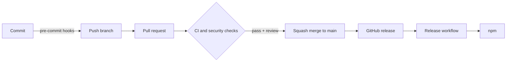

# Architecture

How the pieces of Saccade Keyboards fit together. For day-to-day commands, see [development](development.md). For one-time repository settings, see [repository setup](repo-setup.md).

## Overview

A change moves through three layers of checks before it reaches `main`, and a release moves through one more before it reaches npm.



## Layers

| Layer        | What runs                                                                                                                                                                                       | Where            |
| ------------ | ----------------------------------------------------------------------------------------------------------------------------------------------------------------------------------------------- | ---------------- |
| Local        | gitleaks, file hygiene, actionlint, Prettier, ESLint, Vitest, Sweepito scan and cleanup                                                                                                         | pre-commit hooks |
| Pull request | `ci` (lint, tests with coverage on Node 22, 24 and 26 on Ubuntu plus Node 24 on Windows and macOS, build and package checks), dependency review, CodeQL, Semgrep (`security.yml`, not required) | GitHub Actions   |
| Repository   | Branch ruleset, secret scanning with push protection, Dependabot alerts and updates                                                                                                             | GitHub settings  |
| Release      | Tag and version check, build, trusted publish to npm with provenance                                                                                                                            | `release.yml`    |

## Source layout

```text
packages/<name>/       one publishable package: src/, tests next to source, own vite.config.js
examples/demo/         the demo app, which uses every package
scripts/               repository helper scripts (see scripts/README.md)
vitest.config.js       runs every package as a Vitest project, sets coverage thresholds
eslint.config.js       shared lint rules
jsconfig.json          JSDoc type checking (plain JavaScript, no TypeScript)
package-lock.json      locked dependency set, installed in CI with `npm ci`
```

Each package owns its version in its `package.json`, builds on its own with Vite library mode, and ships ES modules plus `.d.ts` files generated from JSDoc. Packages never import from an application. The release workflow compares the release tag with the package version.

## Workflows

| Workflow                | Trigger                                                           | Purpose                                                                                                                      |
| ----------------------- | ----------------------------------------------------------------- | ---------------------------------------------------------------------------------------------------------------------------- |
| `ci.yml`                | Pull request, push to `main`                                      | Runs `lint`, `test` and `build` in parallel. A final `ci` job gates on all three and is the only check the ruleset requires. |
| `dependency-review.yml` | Pull request                                                      | Blocks pull requests that add vulnerable dependencies.                                                                       |
| `audit.yml`             | Weekly, manual, and pull requests that change `package-lock.json` | Runs `npm audit` on production dependencies to catch newly published vulnerabilities.                                        |
| `security.yml`          | Pull request, push to `main`, weekly, manual                      | Runs Semgrep and uploads SARIF to the Security tab. Not part of the required `ci` check.                                     |
| `release.yml`           | GitHub release published                                          | Checks the tag matches the package version, builds, then publishes that package to npm.                                      |

CodeQL runs through GitHub's default setup rather than a workflow file.

## Branch governance

The `main` ruleset in `.github/rulesets/main.json` is applied by hand (see [repository setup](repo-setup.md)). It requires:

- a pull request with a code owner review and resolved conversations, squash merge only
- the `ci` and `dependency-review` checks, with the branch up to date
- CodeQL results
- no deletion and no force push

Repository admins can bypass through a pull request so a solo maintainer is not locked out.

## Release flow

1. Bump `version` in the package's `package.json` in a pull request.
2. After merge, publish a GitHub release tagged `<package name>@<version>`, for example `@coldsofttech/saccade-keyboards@1.0.0`.
3. `release.yml` builds and packs that package in one job, then a second job in the `npm` environment publishes it using OpenID Connect. No token is stored, and only the publish job gets the `id-token` permission.

## Packages

| Package                           | What it is                                                                  |
| --------------------------------- | --------------------------------------------------------------------------- |
| `@coldsofttech/saccade-keyboards` | The `Keyboard` component, the registry and the layout helpers shared by all |
| `@coldsofttech/saccade-en`        | English: US, GB, AU, CA and IN, QWERTY or alphabetical                      |
| `@coldsofttech/saccade-es`        | Spanish: ES, MX, AR, CO, US and Latin America                               |
| `@coldsofttech/saccade-fr`        | French: FR, BE, CA and CH                                                   |
| `@coldsofttech/saccade-hi`        | Hindi: InScript or phonetic, with Latin or Devanagari digits                |
| `@coldsofttech/saccade-te`        | Telugu: InScript or phonetic, with Latin or Telugu digits                   |
| `@coldsofttech/saccade-ur`        | Urdu: standard or phonetic, with Latin or Urdu digits                       |

## Keyboard package

`packages/saccade-keyboards` has two entry points:

| Entry                                       | What it is                                                                                                      |
| ------------------------------------------- | --------------------------------------------------------------------------------------------------------------- |
| `@coldsofttech/saccade-keyboards`           | `Keyboard` picked by `language`, with a registry that loads each layout when first needed.                      |
| `@coldsofttech/saccade-keyboards/core`      | The engine: `Keyboard` for a layout object, `useKeyboard`, `applyKey`, `validateLayout` and the layout helpers. |
| `@coldsofttech/saccade-keyboards/style.css` | The styles, imported once by the app.                                                                           |

Each language is its own package, `@coldsofttech/saccade-<lang>` (for example `saccade-en`), holding its layouts and depending on `saccade-keyboards/core` as a peer. The layout format is described in [layout format](layout-format.md), and the steps to add a language are in [adding a language](adding-a-language.md).

### Sizing

The keyboard fills the width of its parent and needs at least 430 px, or 600 px with the number pad. At 800 px or less, a CSS container query hides the second and third characters of a key (the Shift symbol and the AltGr corner) until Shift or AltGr is pressed, because the keys are too small to show them without overlapping.

`Keyboard` never edits a field. It reports key presses through `onKey`, and the app applies them, with `applyKey` for a plain input or textarea. Keys sit left to right for every language, because they follow the physical keys, so the keyboard is always `dir="ltr"`.
